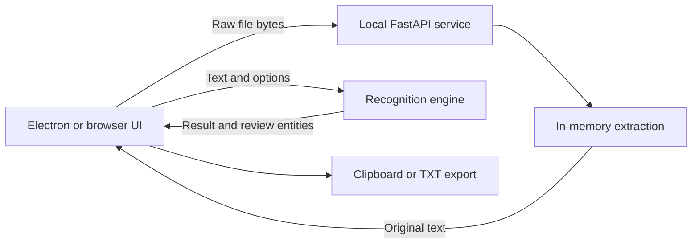

# Velide architecture

Velide has one shared web interface and recognition engine. Electron is a desktop shell for that interface; it does not recreate the UI with native widgets.

## Components

| Component | Responsibility |
| :--- | :--- |
| `desktop/electron/main.cjs` | Electron lifecycle, private-service ownership, renderer restrictions and packaged verification. |
| `desktop/service.py` | Bundled loopback FastAPI service; readiness handshake and shutdown on parent-pipe EOF. |
| `desktop/launcher.py` | Development entry point for `npm start`. |
| `backend/app/main.py` | Endpoints, raw upload stream, privacy headers and static assets. |
| `backend/app/schemas/` | Request/response contracts, supported formats and text/options validation. |
| `backend/app/services/text_ingestion.py` | In-memory PDF/DOCX/TXT/MD parsing and stable error codes. |
| `backend/app/services/languages.py` | Language metadata, regexes, labels and fictional examples. |
| `backend/app/services/person_context.py` | Names and identifiers from explicit fields/tables. |
| `backend/app/services/profile_context.py` | URLs, professional-profile cues and explicit city/country patterns. |
| `backend/app/services/redaction_engine.py` | Detection, category filtering, repeats, overlap merging and replacements. |
| `backend/app/static/` | Shared frontend, translations, themes and branding. |
| `scripts/build_windows.py` | Service freeze, Electron packaging, desktop check, ZIP, checksums and shortcut verification. |
| `tests/`, `scripts/verify_ui.cjs` | Synthetic Python regressions and browser interaction checks. |

Legacy native GUI files are not used by the Electron entry point or shipped as an alternative interface. Historical `patterns.py`/`pseudonymizer.py` helpers are not authoritative extension points; the current engine and language modules define behavior.

## Data flow and lifecycle

Electron starts one private child, waits for its loopback URL, then loads the shared UI. It normally uses port 8760, with a free-port fallback; a bound socket is retained while the server starts to avoid a port-selection race. Single-instance handling focuses the existing window. Closing Electron ends the child input pipe; EOF also stops the service when the parent crashes. A delayed process termination is a fallback.

The renderer has no Node integration or preload bridge, uses sandbox/context isolation, and loads only the local origin. Popups, external navigation and external session requests are blocked. UserData stores ordinary Electron state and language/theme preferences; clinical documents are not intentionally persisted.

## Import contract

`POST /api/ingest/file?format=pdf` receives a binary request body, not multipart. Stream bytes are accumulated up to 10 MiB without `UploadFile` spooling. Extraction runs in a thread via `run_in_threadpool`; this does not isolate the parser or impose a CPU timeout. Cancelling a browser request prevents a stale result but does not necessarily stop parser work already running.

`extract_text(bytes, format)` returns `IngestResponse` or raises `IngestionError(code, status)`. Return stable codes, never parser messages or document text. The frontend localizes errors. DOCX tables use tabs between cells and newlines between rows, preserving field/value associations. PDF extraction can alter layout and reading order. Empty/mixed PDFs must remain distinguishable from complete extraction.

| Budget | Value |
| :--- | :--- |
| Upload | 10 MiB |
| Extracted text | 200,000 Python Unicode characters |
| PDF pages | 200 |
| DOCX ZIP entries / declared expanded content | 1,000 / 30 MiB |
| Nested Word table depth | 20 |
| Main PDF decoder/page-content output | 5 MiB |
| PDF stream decoding work | 20 MiB |
| Page-tree visits / XObject form invocations | 2,000 / 128 |

DOCX accepts ZIP Stored/Deflate and never extracts the archive onto disk. PDF limits use `pypdf.apply_configuration` during decoding, with context restored after errors. These are parser budgets, not a global process memory/CPU quota or concurrency limit.

## Recognition contract

The engine receives original text and validated options. Offsets are Python Unicode indices, `[start, end)`, not JavaScript UTF-16 indices. Merging overlapping detections avoids exposing a tail of sensitive text; the first detection supplies the merged type. Preserve boundaries and category filters when modifying patterns.

Pseudonym maps are per request. Full responses include original values for review, so callers must not share or log them. Unlabeled/indirect identifiers can remain; no universal name recognition, anonymity guarantee or legal-compliance assertion should be added to product copy.

## Frontend behavior

An explicit saved language wins. Otherwise use Electron's system-language hint or the browser's ordered preferences, normalize regional tags and select the first supported language. Default to English if none match. Theme defaults to system and is applied before CSS. Document language controls recognition as well as UI labels.

`revision` and `AbortController` protect redaction responses; `importGeneration` protects imports. Edits, Clear, a new document or a loaded example invalidate obsolete work. `dragDepth` prevents nested drag events from flickering. Always render document/entity content as text, never HTML.

## Extend the app

### A new language

1. Add metadata, conservative regexes, labels and a fictional sample in `languages.py`.
2. Update allowed language values in schemas and `/api/sample`, and the frontend language menu.
3. Add complete UI, theme, upload/error and footer translations in `i18n.js`; keep its key/row counts aligned.
4. Update Electron's supported-language selection and add positive and negative synthetic tests for names, titles, dates, contacts and identifiers.
5. Check all masking modes, repeated values, category disabling, overlaps and narrow layouts. Mixed-language text still requires review.

### A new format or OCR

Add the format to schema, parser dispatch and picker/drop validation. Keep parsing in memory, apply explicit limits before expensive operations and return stable errors. OCR should be an explicit locally installed/bundled capability; warn about partial extraction and missing dependencies. Do not claim preserved layout or masked images when only extracted text is returned.

### A recognition change

Add a value that should be masked and a similar value that should remain visible. Verify offsets, repeats, overlaps, disabled categories and custom terms. Use synthetic documents, not real clinical records.

## Verification and release

Follow the README commands for Python tests, Ruff and JavaScript formatting. Browser verification uses Playwright and synthetic upload fixtures. Packaged verification executes the actual Electron application, checks the renderer sandbox, logos, themes, English masking and bundled import, then saves a local result and screenshot under `build/`.

The Windows build packages a per-user NSIS installer and complete portable ZIP. Do not publish an old native/Tk executable under the same release. Upload matching assets and SHA-256 files manually. Electron/npm versions are pinned in `package-lock.json`; update them deliberately and rerun checks. Keep dependency license notices in the distribution. Signing is not configured yet.

Security boundaries: in-memory ingestion does not erase swap, crash dumps, browser state or clipboard history. `no-store` is an HTTP-cache directive, not secure deletion. TrustedHost/CSP do not authenticate users. The current app is local-only; authentication, parser isolation, global resource/concurrency limits and a new threat review are required before treating it as a hosted multiuser service.
